<h1 align="center">Clair Obscur Expedition 33 Companion</h1>

The companion for the <a href="https://github.com/abdullahhasan42/clair-obscur-expedition-33-theme">Clair Obscur Expedition 33 theme</a>. Every empty tab becomes a title screen with diamond command tiles after the game's Pictos and skill tree. Saving parries, deleting is the Gommage, and reaching your daily goal is a VICTORY. Three styles: <b>Lumière at night</b>, <b>Gommage</b> and <b>Expedition 33</b>.

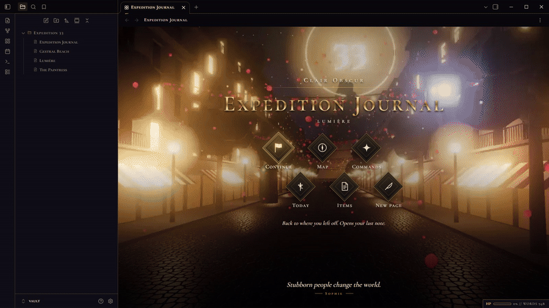

Title screens, clicking and keys through the diamonds, "Parry it!" and the rising Gommage petals.

<a href="#title-screens">Title screens</a> ·
<a href="#menu-layouts">Menu layouts</a> ·
<a href="#saving">Saving</a> ·
<a href="#area-titles-and-dialogue">Area titles</a> ·
<a href="#victory-and-pause">VICTORY and Pause</a> ·
<a href="#commands">Commands</a> ·
<a href="#install">Install</a>

<h2 align="center" id="title-screens">Title screens</h2>

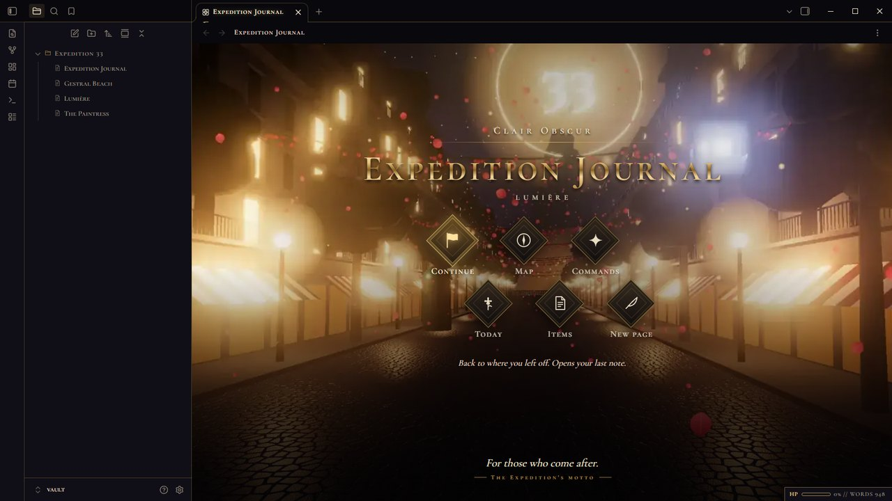

<b>Lumière at night.</b> Your vault name in brushed gold over the boulevard, six diamond commands, and a line from the game at the foot.

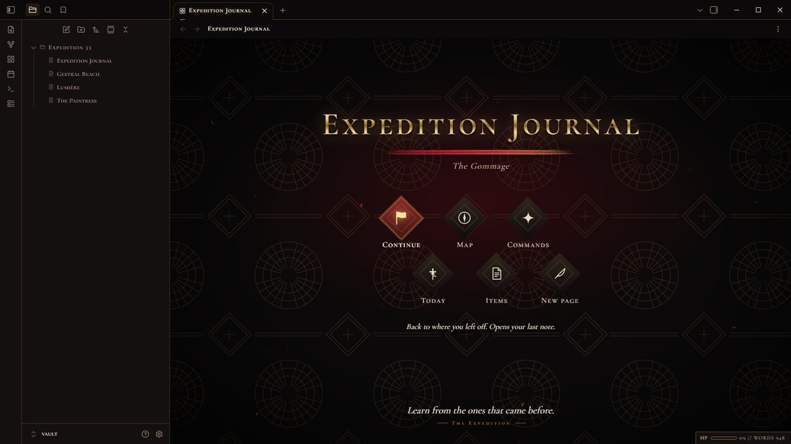 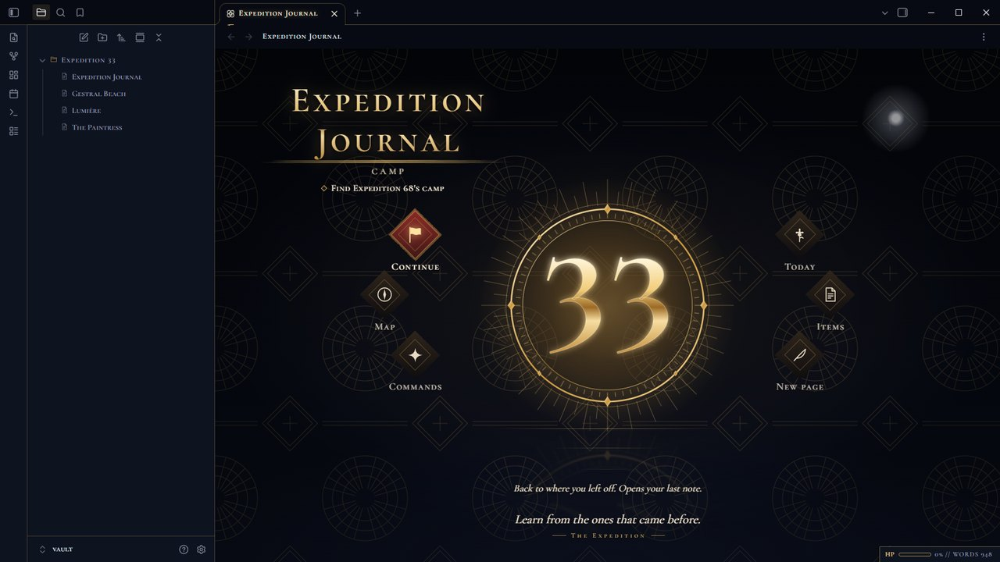

<b>Gommage</b>, your name on a brush stroke &nbsp;·&nbsp; <b>Expedition 33</b>, the emblem dead centre with the diamonds around it

Commands: **Continue** (your last note), **Map** (graph), **Commands** (palette), **Today** (daily note), **Items** (quick switcher), **New page**. Use the mouse, the arrow keys, Home, End, Enter or 1 to 6.

<h2 align="center" id="menu-layouts">Menu layouts</h2>

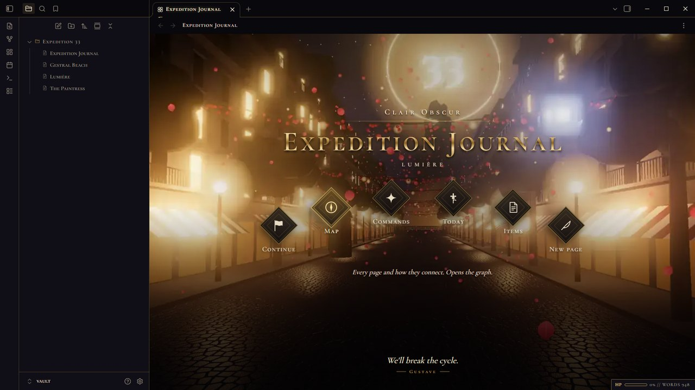 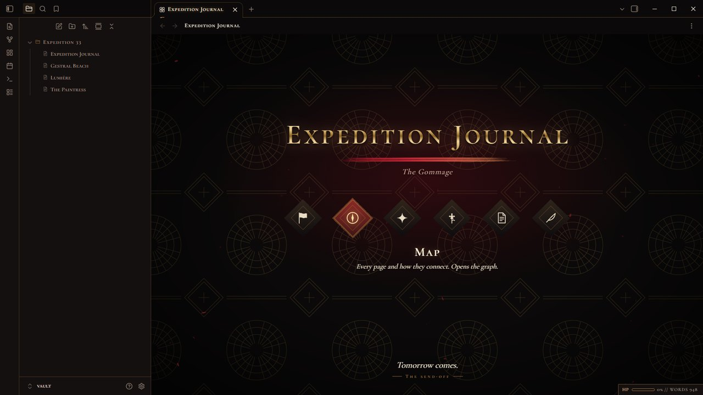

<b>Diamonds on an arc</b> &nbsp;·&nbsp; <b>Diamond row</b> with one large caption

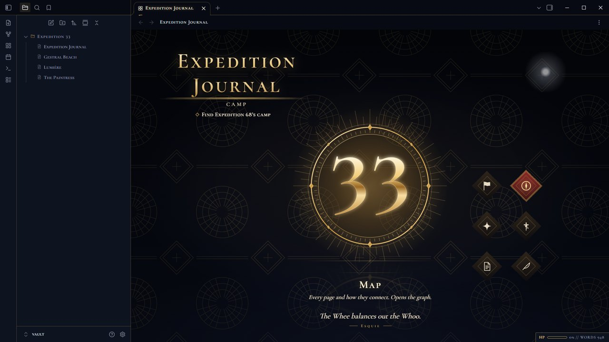

<b>Expedition 33</b> with every command on the right of the emblem (or split left and right, the default)

<h2 align="center" id="saving">Saving</h2>

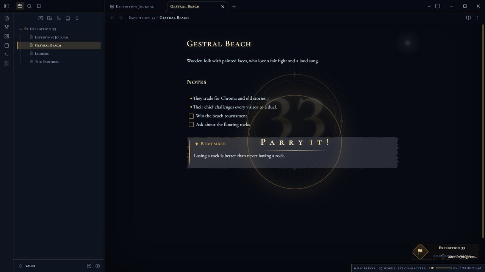 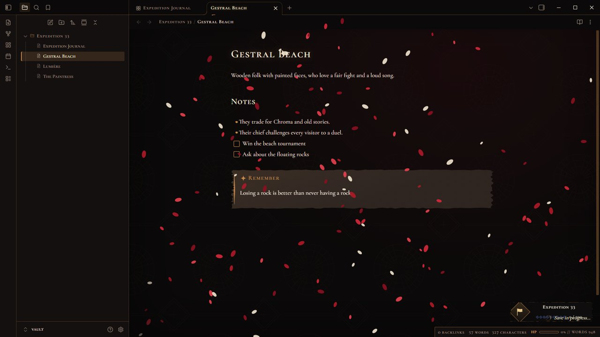

<b>Parry it!</b> Two gold glints meet and the words land (Lumière and Expedition) &nbsp;·&nbsp; <b>Gommage</b>, red petals rise from a bottom corner across the page

The classic "Parry" ring stays available under **Save effect** in Style Settings. The first save of a vault gets Maelle's "Parry it!"; three quick saves get "Parry it! (No, not Harriet.)".

<h2 align="center" id="area-titles-and-dialogue">Area titles and dialogue</h2>

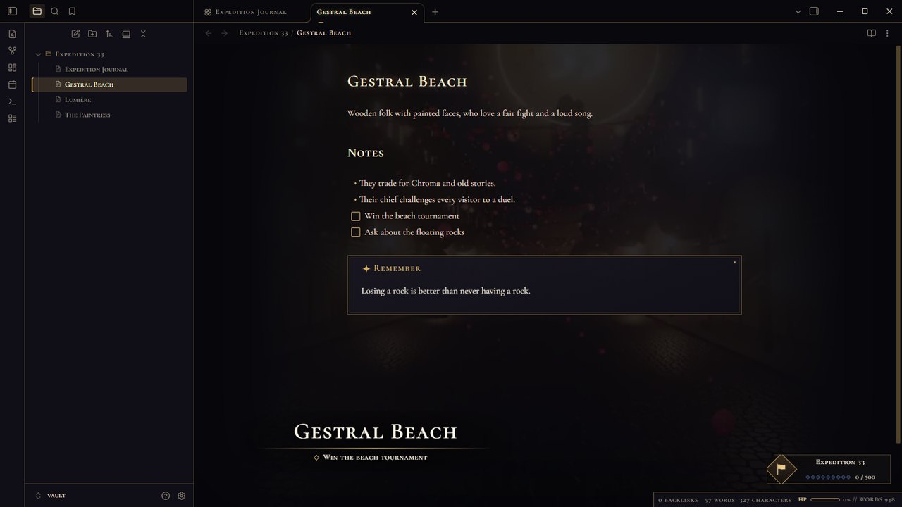 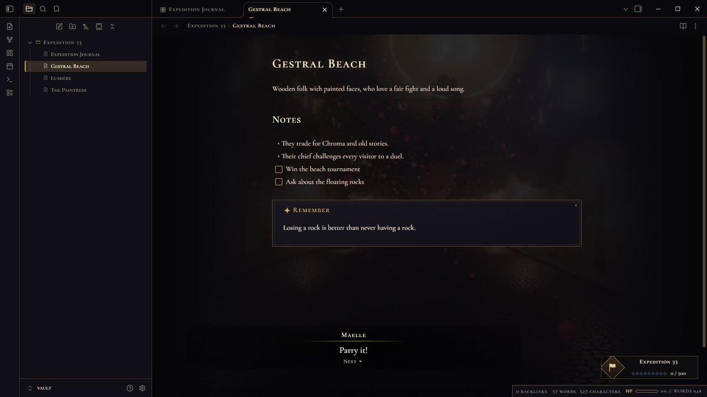

<b>Area title</b> at the bottom left when a note opens, with its first open task &nbsp;·&nbsp; <b>Dialogue</b> lines from the cast

<h2 align="center" id="victory-and-pause">VICTORY and Pause</h2>

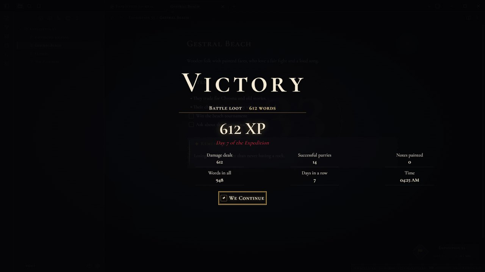 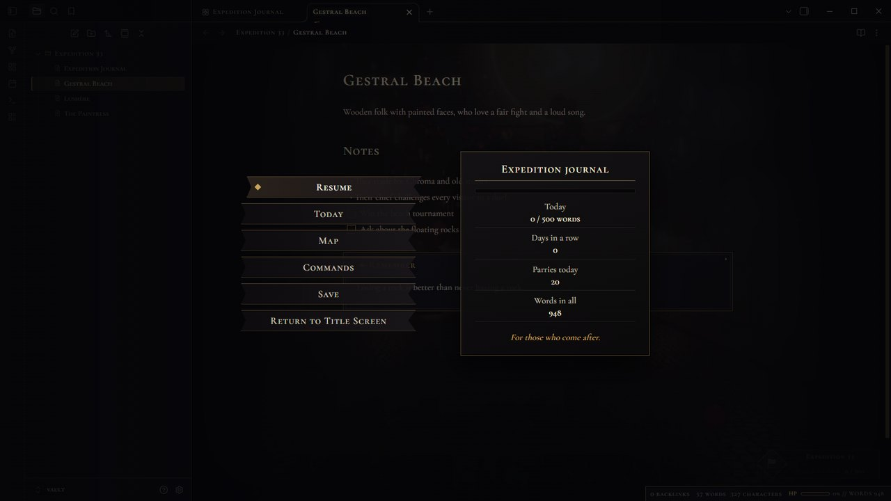

<b>VICTORY</b> when today's word goal is reached &nbsp;·&nbsp; <b>Pause</b> with the expedition journal

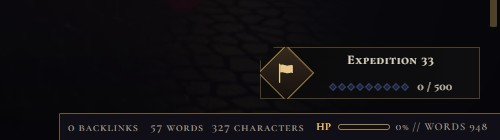

<b>Party plate HUD</b>: today's words against your goal, in the status bar

Also: **Dodge** on undo, **EXPEDITION FAILED** when a streak breaks, and the **Gommage** in petals when a note is deleted. Every effect has a switch and respects reduced motion.

<h2 align="center" id="commands">Commands</h2>

| Command | What it does |
| --- | --- |
| Save (parry it) | Saves the note with the style's save effect |
| Return to the title screen | Opens the title screen |
| Switch world | Cycles the three styles |
| Pause | Opens the pause screen |
| Show the area title | Shows the current note's area title |
| Open the expedition journal | Opens the journal |

<h2 align="center" id="settings">Settings</h2>

With the theme and **Style Settings**: world, texture, menu layout, Expedition placement, quote mode, save effect, painting behind notes, and a switch for every effect.

In **Settings → Clair Obscur Expedition 33 Companion**: title text (empty = your vault name), daily word goal, and the menu entries.

<h2 align="center" id="install">Install</h2>

- **Community plugins:** search **Clair Obscur Expedition 33 Companion**, install, enable.
- **BRAT (beta):** install BRAT, run **BRAT: Add a beta plugin**, enter `abdullahhasan42/clair-obscur-expedition-33-plugin`, then enable it.
- **Manual:** download `main.js`, `manifest.json` and `styles.css` from the latest release into `<vault>/.obsidian/plugins/clair-obscur-expedition-33-companion/`.

Everything lives in `main.js` and `styles.css`; the art is embedded. Static art, about 0 % GPU on the title screens, about 1 % while the Gommage petals move.

<h2 align="center" id="license">License</h2>

MIT (see `LICENSE`). The plugin embeds Cormorant SC and Cormorant Garamond in `styles.css`, so it keeps its look under any theme; they are under the SIL Open Font License (`fonts/OFL-Cormorant.txt`).

> Unofficial fan project, made out of love for Clair Obscur: Expedition 33. Not affiliated with or endorsed by Sandfall Interactive or Kepler Interactive. No game art, logos or fonts are included; every image is an original render or drawing. Quoted lines are short excerpts used for commentary.
